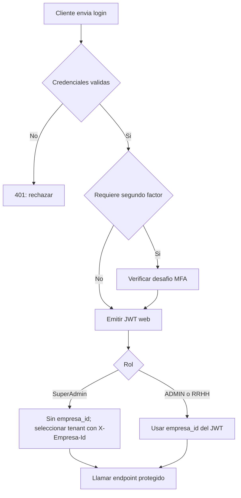
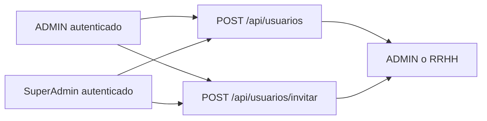

# Contrato HTTP y autenticacion

Volver al [[Inicio|indice]], consultar [[API/02-Agentes-biometricos|agentes biometricos]] o ver [[API/03-Seguridad-web|seguridad web, sesiones y MFA]].

## Autenticacion web

Las operaciones web protegidas requieren un JWT de acceso:

```http
Authorization: Bearer <token>
```

El login web recibe `email` y `password`:

```http
POST /api/auth/login
Content-Type: application/json

{
  "email": "usuario@dominio.local",
  "password": "<contrasena>"
}
```

Un login normal responde con `token` y `mensaje`. Si la cuenta tiene TOTP
habilitado, primero responde con un desafio MFA y no emite JWT ni cookie. Las
contrasenas se almacenan como hash mediante `PasswordHasher<Usuario>`; nunca
deben almacenarse ni devolverse en texto plano. Ver
[[API/03-Seguridad-web|el flujo de sesiones y MFA]].

## Flujo de autenticacion web



## Bootstrap del primer usuario

`POST /api/auth/bootstrap` esta deshabilitado por defecto y responde `404`,
incluso si la tabla `Usuario` esta vacia. Solo un laboratorio local puede
habilitarlo de forma explicita mediante `Auth:PermitirBootstrap`; aun asi,
requiere una tabla vacia, la empresa debe existir y el usuario inicial queda
con rol `ADMIN`:

```http
POST /api/auth/bootstrap
Content-Type: application/json

{
  "empresaId": 1,
  "nombreUsuario": "Administrador",
  "email": "admin@empresa.local",
  "password": "<contrasena>",
  "rol": "ADMIN"
}
```

Si se habilita localmente, devuelve un JWT. Si ya hay usuarios, responde
`409 Conflict`; no crea un `SuperAdmin`. En el funcionamiento normal, el
bootstrap no se utiliza.

## Roles y contexto de empresa

- `SuperAdmin` es una cuenta activa existente con `Rol = "SuperAdmin"`. Su JWT
  web no incluye `empresa_id`.
- Para operaciones administrativas sobre una empresa, `SuperAdmin` selecciona
  el tenant con `X-Empresa-Id`. La consulta global de empresas no requiere
  seleccionar uno.
- `ADMIN` y `RRHH` quedan limitados a `empresa_id` en su JWT. No pueden cambiar
  de empresa enviando `X-Empresa-Id`.
- Los roles permitidos para altas y cambios de rol de usuarios son `ADMIN` y
  `RRHH`; estos endpoints no permiten asignar `SuperAdmin`.

Ejemplo de seleccion de contexto:

```http
GET /api/sucursales
X-Empresa-Id: 2
```

`SuperAdmin` se autentica con `POST /api/auth/login`; el primer usuario de
bootstrap es `ADMIN`, no `SuperAdmin`. Para habilitar una cuenta de
`SuperAdmin`, debe existir activa en la base con `Rol = "SuperAdmin"`.

El `GET /api/usuarios` de `SuperAdmin` puede operar globalmente o filtrar por
`empresaId` en query; tambien puede usar `X-Empresa-Id` para fijar contexto.
Sin un header de empresa valido, el contexto queda global. `ADMIN` y `RRHH`
usan exclusivamente el tenant de su JWT.

## Alta posterior de usuarios

`POST /api/usuarios` permite altas con contrasena segun la configuracion y los
permisos del operador. Ejemplo:

```http
POST /api/usuarios
Authorization: Bearer <token>
Content-Type: application/json

{
  "empresaId": 1,
  "nombreUsuario": "Juan Perez",
  "email": "juan@empresa.local",
  "password": "<contrasena>",
  "rol": "RRHH"
}
```

Las contrasenas se almacenan como hash y no se devuelven. Un `ADMIN` solo crea
usuarios `RRHH` de su empresa; el `empresaId` enviado se ignora y se fuerza el
tenant del JWT. El rol `ADMIN` enviado por ese operador se rechaza con `400`.
`SuperAdmin` puede crear `ADMIN` o `RRHH`, pero `X-Empresa-Id` debe coincidir
con `body.empresaId`.

Tambien existe el alta por invitacion, que no recibe contrasena y envia un
enlace de aceptacion. El flujo y sus rutas estan en
[[API/03-Seguridad-web|seguridad web, sesiones y MFA]].

Los usuarios se crean desde un contexto autenticado:



## Rutas relacionadas

- [[Administracion/01-Empresas-y-sucursales|Empresas y sucursales]]
- [[Administracion/02-Usuarios|Gestion de usuarios]]
- [[API/03-Seguridad-web|Sesiones, MFA, invitaciones y recuperacion]]
- [[Operacion/01-Empleados-y-huellas|Empleados y huellas]]
- [[Operacion/02-Fichadas|Fichadas]]
- [[Operacion/03-Turnos-y-jornadas|Turnos y jornadas]]
