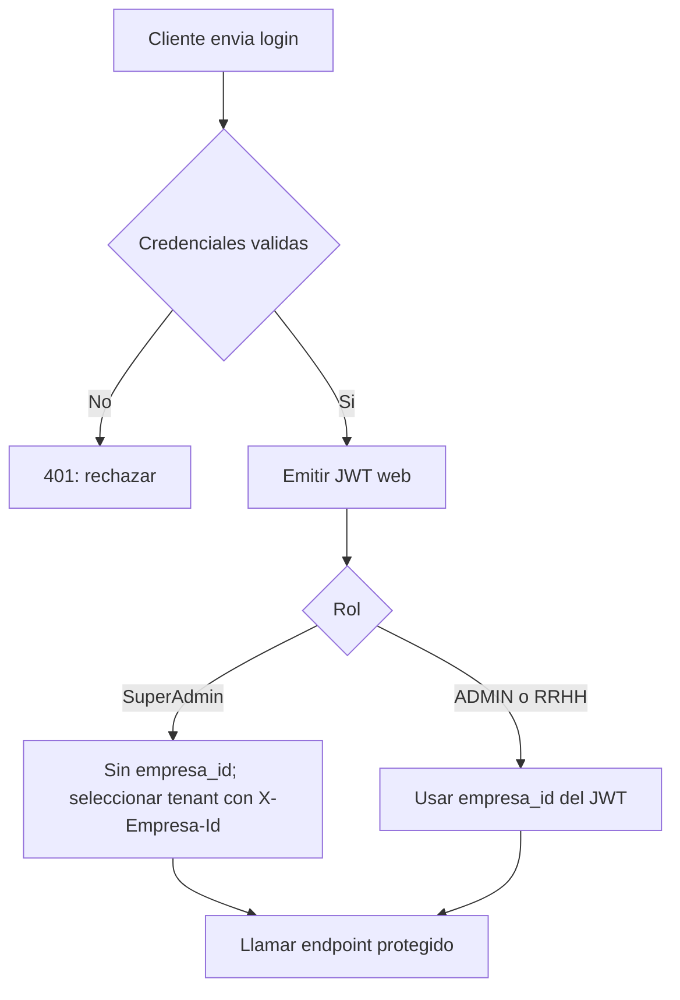
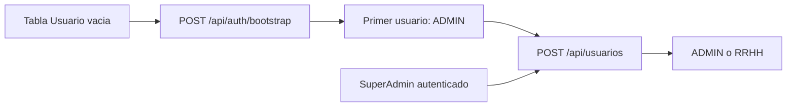

# Contrato HTTP y autenticacion

Volver al [[Inicio|indice]] o consultar [[API/02-Agentes-biometricos|agentes biometricos]].

## Autenticacion web

Salvo login web/agente y bootstrap, las operaciones protegidas requieren un
JWT:

```http
Authorization: Bearer <token>
```

El login web recibe `email` y `password`:

```http
POST /api/auth/login
Content-Type: application/json

{
  "email": "usuario@dominio.local",
  "password": "<contrasena>"
}
```

La respuesta contiene `token` y `mensaje`. Las contrasenas se almacenan como
hash mediante `PasswordHasher<Usuario>`; nunca deben almacenarse ni devolverse
en texto plano.

## Flujo de autenticacion web



## Bootstrap del primer usuario

`POST /api/auth/bootstrap` solo funciona si la tabla `Usuario` esta vacia. La
empresa debe existir y el usuario inicial queda con rol `ADMIN`:

```http
POST /api/auth/bootstrap
Content-Type: application/json

{
  "empresaId": 1,
  "nombreUsuario": "Administrador",
  "email": "admin@empresa.local",
  "password": "<contrasena>",
  "rol": "ADMIN"
}
```

Devuelve un JWT. Si ya hay usuarios, responde `409 Conflict`; a partir de ese
momento se crean usuarios con un administrador autenticado. El bootstrap no
crea un `SuperAdmin`.

## Roles y contexto de empresa

- `SuperAdmin` es una cuenta activa existente con `Rol = "SuperAdmin"`. Su JWT
  web no incluye `empresa_id`.
- Para operaciones administrativas sobre una empresa, `SuperAdmin` selecciona
  el tenant con `X-Empresa-Id`. La consulta global de empresas no requiere
  seleccionar uno.
- `ADMIN` y `RRHH` quedan limitados a `empresa_id` en su JWT. No pueden cambiar
  de empresa enviando `X-Empresa-Id`.
- Los roles permitidos para altas y cambios de rol de usuarios son `ADMIN` y
  `RRHH`; estos endpoints no permiten asignar `SuperAdmin`.

Ejemplo de seleccion de contexto:

```http
GET /api/sucursales
X-Empresa-Id: 2
```

`SuperAdmin` se autentica con `POST /api/auth/login`; el primer usuario de
bootstrap es `ADMIN`, no `SuperAdmin`. Para habilitar una cuenta de
`SuperAdmin`, debe existir activa en la base con `Rol = "SuperAdmin"`.

El `GET /api/usuarios` de `SuperAdmin` puede operar globalmente o filtrar por
`empresaId` en query; tambien puede usar `X-Empresa-Id` para fijar contexto.
Sin un header de empresa valido, el contexto queda global. `ADMIN` y `RRHH`
usan exclusivamente el tenant de su JWT.

## Alta posterior de usuarios

`POST /api/usuarios` permite crear usuarios despues del bootstrap. Ejemplo:

```http
POST /api/usuarios
Authorization: Bearer <token>
Content-Type: application/json

{
  "empresaId": 1,
  "nombreUsuario": "Juan Perez",
  "email": "juan@empresa.local",
  "password": "<contrasena>",
  "rol": "RRHH"
}
```

Las contrasenas se almacenan como hash y no se devuelven. Un `ADMIN` solo crea
usuarios `RRHH` de su empresa; el `empresaId` enviado se ignora y se fuerza el
tenant del JWT. El rol `ADMIN` enviado por ese operador se rechaza con `400`.
`SuperAdmin` puede crear `ADMIN` o `RRHH`, pero `X-Empresa-Id` debe coincidir
con `body.empresaId`.

El recorrido inicial es bootstrap de una sola vez; los usuarios posteriores se
crean desde un contexto autenticado:



## Rutas relacionadas

- [[Administracion/01-Empresas-y-sucursales|Empresas y sucursales]]
- [[Administracion/02-Usuarios|Gestion de usuarios]]
- [[Operacion/01-Empleados-y-huellas|Empleados y huellas]]
- [[Operacion/02-Fichadas|Fichadas]]
- [[Operacion/03-Turnos-y-jornadas|Turnos y jornadas]]
