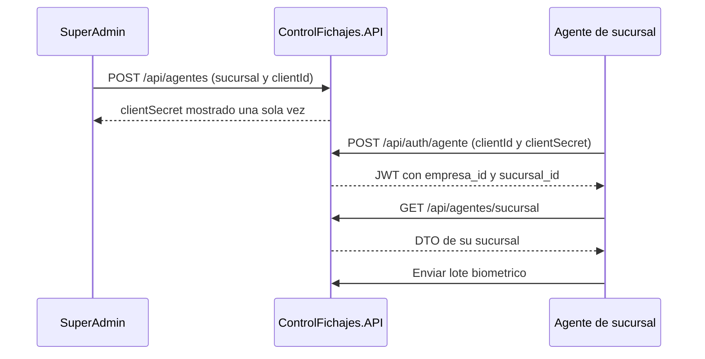

# Agentes biometricos

Volver al [[Inicio|indice]]. El agente es una instalacion de servicio vinculada
a una sucursal; no es una cuenta de usuario humano ni usa el login web. El
codigo de la aplicacion del lector no forma parte de este repositorio.

## Rutas

```text
POST  /api/auth/agente
POST  /api/agentes
GET   /api/agentes
GET   /api/agentes/{id}
POST  /api/agentes/{id}/rotar-secret
PATCH /api/agentes/{id}/desactivar
GET   /api/agentes/sucursal
POST  /api/agentes/{id}/heartbeat
```

Solo `SuperAdmin` puede crear, listar, consultar, rotar o desactivar agentes.
El agente autenticado puede consultar su sucursal; el heartbeat solo acepta el
token cuyo `agente_id` coincide con el identificador de la ruta.

## Alta y uso del agente



Las operaciones de administracion son globales y solo requieren el JWT de
`SuperAdmin`. Al crear el agente se especifican sucursal, `clientId` y nombre:

```http
POST /api/agentes
Authorization: Bearer <token>
Content-Type: application/json

{
  "sucursalId": 2,
  "clientId": "lector-sucursal-2",
  "nombre": "Lector principal"
}
```

## Credenciales y token

Para iniciar sesion se envia `clientId` y `clientSecret`:

```http
POST /api/auth/agente
Content-Type: application/json

{
  "clientId": "lector-central",
  "clientSecret": "<secreto>"
}
```

El JWT de agente contiene `token_use = agent`, `agente_id`, `empresa_id`,
`sucursal_id` y el rol `AGENTE_SUCURSAL`.

La API persiste un hash en `AgenteInstalaciones.ClientSecretHash`. El secreto
en claro se entrega una sola vez al crear o rotar el agente: entregarlo al
instalador biometrico y no guardarlo en el frontend, logs ni telemetria. El
estado persistido disponible es `UltimoAcceso`.

## Sucursal y permisos

`GET /api/agentes/sucursal` devuelve el DTO de sucursal, incluido
`serialLector`, para que el agente consulte el lector de su sucursal sin un JWT
web administrativo ni acceso a otro tenant.

El endpoint heartbeat persiste `UltimoAcceso`, que es el unico dato de estado
disponible en la tabla actual.

Los tokens de agente pueden consultar catalogo de empleados y huellas, enrolar
huellas y registrar fichadas biometricas. No habilitan operaciones web de
administracion, empresas, sucursales, usuarios ni consulta de fichadas
historicas.

Se conserva `POST /api/fichadas/bulk` para integraciones existentes. Ver
[[Operacion/01-Empleados-y-huellas|empleados y huellas]] y
[[Operacion/02-Fichadas|fichadas]].
