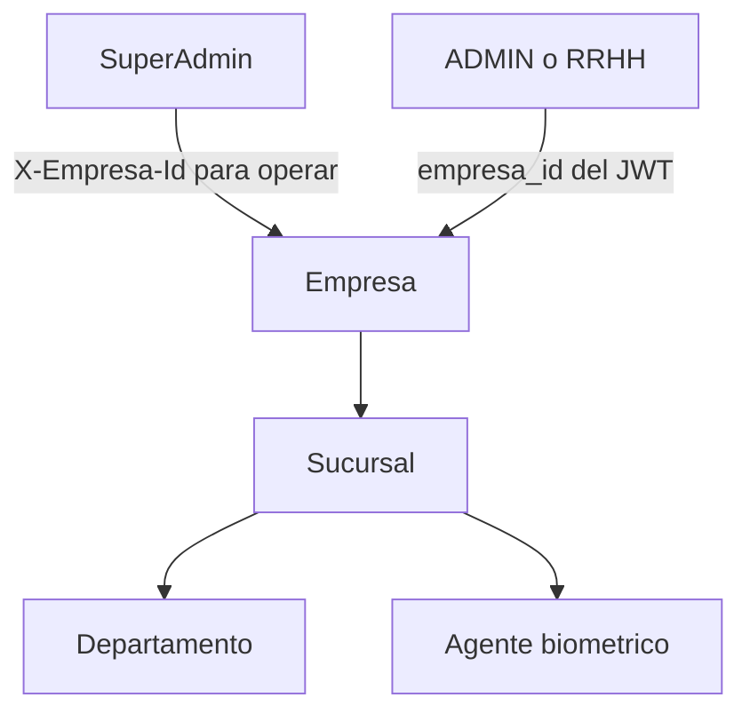

# Empresas y sucursales

Volver al [[Inicio|indice]] o consultar [[API/01-Contrato-y-autenticacion|autenticacion y contexto tenant]].

## Empresas

```text
GET  /api/empresas
POST /api/empresas
```

- `GET`: `SuperAdmin` obtiene todas las empresas. `ADMIN` y `RRHH` solo ven la
  empresa de su claim `empresa_id`.
- `POST`: solo `SuperAdmin` puede crear una empresa.

El JWT de `SuperAdmin` no contiene `empresa_id`; para operaciones sobre una
empresa concreta envia `X-Empresa-Id`. Los roles `ADMIN` y `RRHH` no pueden
seleccionar otro tenant mediante ese header.

## Jerarquia y contexto



## Sucursales

```text
GET    /api/sucursales
GET    /api/sucursales/{id}
POST   /api/sucursales
PUT    /api/sucursales/{id}
DELETE /api/sucursales/{id}
```

Las sucursales pertenecen a la empresa del usuario autenticado. Solo
`SuperAdmin` crea sucursales y debe enviar `X-Empresa-Id` para seleccionar la
empresa operativa.

Las consultas devuelven `id`, `nombre`, `empresaId` y `serialLector`. Los
departamentos se consultan por separado mediante `/api/departamentos`, para
evitar ciclos en la serializacion.

## Agentes

Los agentes se vinculan a una sucursal y tienen rutas administrativas globales
para `SuperAdmin`. Ver [[API/02-Agentes-biometricos|agentes biometricos]].
