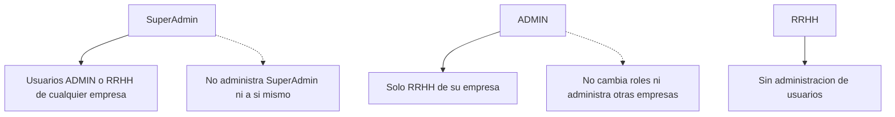
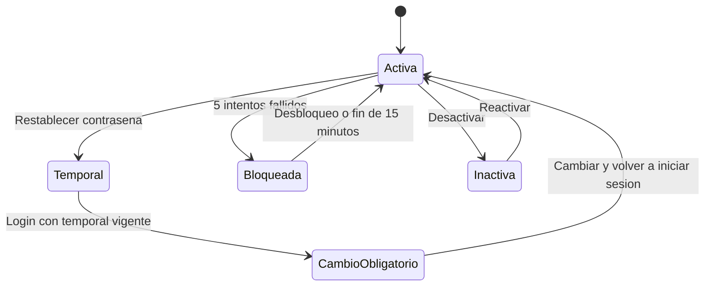

# Usuarios

Volver al [[Inicio|indice]] o consultar [[API/01-Contrato-y-autenticacion|login y bootstrap]].

## Rutas

```text
GET    /api/usuarios
POST   /api/usuarios
PATCH  /api/usuarios/{id}/estado
PATCH  /api/usuarios/{id}/rol
POST   /api/usuarios/{id}/restablecer-password
POST   /api/usuarios/{id}/desbloquear
POST   /api/auth/cambiar-password
```

No existe borrado fisico de usuarios. La baja/reactivacion se realiza con
`PATCH /estado` y conserva identidad, empresa, rol, fichadas, relaciones e
historial.

## Alcance por rol

| Rol | Alcance |
| --- | --- |
| `SuperAdmin` | Lista y administra usuarios `ADMIN`/`RRHH` de cualquier empresa. No administra a otro `SuperAdmin`, no se opera a si mismo y no crea ni asigna `SuperAdmin`. |
| `ADMIN` | Lista usuarios de su empresa y crea, desactiva, reactiva, restablece o desbloquea usuarios `RRHH` de esa empresa. No cambia roles ni opera sobre otras cuentas/empresas. |
| `RRHH` | Sin acceso administrativo a usuarios. |

Para crear un usuario, `ADMIN` solo puede crear `RRHH` de su empresa; el
`empresaId` del body se ignora y se utiliza el tenant del JWT. `SuperAdmin`
debe enviar `X-Empresa-Id` y debe coincidir con `body.empresaId`; puede crear
`ADMIN` o `RRHH`.

Para operaciones sobre `{id}`, la API verifica el operador y el alcance del
objetivo. Un objetivo inexistente o fuera de alcance responde `404`; un
`ADMIN` que intenta cambiar el rol recibe `403`. `SuperAdmin` no necesita
`X-Empresa-Id` para estado, rol, restablecer contrasena ni desbloquear.

## Alcance administrativo



## DTO seguro

`GET /api/usuarios` devuelve un DTO minimo, por ejemplo:

```json
{
  "id": 1,
  "empresaId": 1,
  "nombreUsuario": "Juan Perez",
  "correo": "juan@empresa.local",
  "rol": "RRHH",
  "activo": true,
  "requiereCambioPassword": false,
  "bloqueado": false,
  "bloqueadoHasta": null
}
```

No incluye `PasswordHash`, secretos, JWT ni contrasenas temporales. La
serializacion es camelCase.

## Estado y rol

`PATCH /api/usuarios/{id}/estado` requiere el campo booleano `activo`; permite
desactivar (`false`) y reactivar (`true`). Body vacio o `null` responde `400`.

`PATCH /api/usuarios/{id}/rol` admite unicamente `ADMIN` y `RRHH`, normalizados
ignorando mayusculas y espacios. Solo `SuperAdmin` puede usarlo.

`SuperAdmin` puede listar globalmente, filtrar con `empresaId` por query o
fijar contexto con `X-Empresa-Id`. Si el header no contiene una empresa valida,
el listado queda global. `ADMIN` solo lista su propia empresa y `RRHH` no puede
acceder al listado.

Ambos PATCH devuelven `200` con `mensaje` y el DTO seguro bajo `usuario`. Un
cambio efectivo incrementa `TokenVersion` una vez e invalida JWT web anteriores;
enviar el valor actual es idempotente. El cambio no altera otros atributos de
la cuenta. El usuario inactivo sigue apareciendo en el listado.

## Contrasenas y bloqueo

- Login: cinco verificaciones fallidas bloquean por 15 minutos. Se responde
  `401` para credenciales incorrectas, cuenta bloqueada o temporal vencida/no
  valida. El bloqueo tambien alcanza a `SuperAdmin`.
- Restablecimiento: genera una contrasena temporal aleatoria de 16 caracteres,
  con letra, numero y caracter especial, sin espacios. Se devuelve en claro una
  sola vez usando un generador criptograficamente seguro y se almacena como
  hash. Vence en 24 horas UTC, marca `RequiereCambioPassword = true` y
  `PasswordTemporalUsada = false`, limpia `IntentosFallidos`,
  `BloqueadoHasta` y `UltimoIntentoFallido`, incrementa `TokenVersion` e
  invalida JWT web anteriores. No se registra en logs, auditoria ni telemetria.
- Cambio obligatorio: `POST /api/auth/cambiar-password` requiere validar la
  contrasena actual. La nueva debe tener entre 8 y 20 caracteres, incluir
  letra, numero y caracter especial, no tener espacios, coincidir con la
  confirmacion y diferir de la actual. Si es un cambio obligatorio, la
  temporal debe estar sin usar y vigente. Al completar, actualiza el hash,
  desactiva `RequiereCambioPassword`, marca `PasswordTemporalUsada = true`,
  limpia el vencimiento y el estado de bloqueo/intentos, incrementa
  `TokenVersion` e invalida el JWT utilizado. El usuario debe iniciar sesion
  nuevamente. Las fallas se responden con `400` y un mensaje generico.
- Desbloqueo: limpia `IntentosFallidos`, `BloqueadoHasta` y
  `UltimoIntentoFallido`, sin cambiar hash, `Activo`,
  `RequiereCambioPassword` ni `PasswordTemporalUsada`.

Un JWT con `requiere_cambio_password=true` solo puede llamar a
`POST /api/auth/cambiar-password`; los demas endpoints web protegidos responden
`403`. Los JWT web protegidos deben tener usuario activo y un
`token_version` entero coincidente con la base; si falta o difiere, responden
`401`. Esta validacion no se aplica a tokens `token_use=agent`.

La documentacion del README indica como deuda: no se incorporan rate limiting,
respuestas `423`/`429` ni incremento atomico de intentos.

No existe una ruta administrativa para definir directamente la contrasena
definitiva de otra cuenta: el flujo es restablecerla y que el usuario complete
el cambio obligatorio.



## Esquema relacionado

Las columnas de seguridad se describen en
[[Operaciones/02-Base-de-datos|scripts y esquema de base de datos]].
