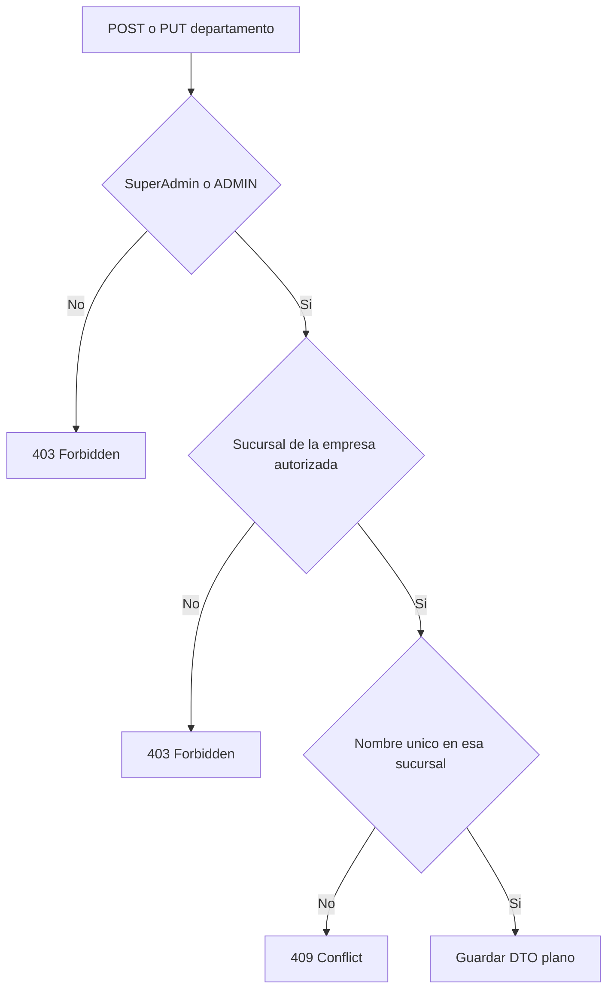

# Departamentos

Volver al [[Inicio|indice]].

## Rutas

```text
GET    /api/departamentos
GET    /api/departamentos/{id}
POST   /api/departamentos
PUT    /api/departamentos/{id}
DELETE /api/departamentos/{id}
```

Los departamentos pertenecen a una sucursal. La sucursal asociada debe estar
dentro de la empresa autorizada por el usuario; si pertenece a otra empresa,
la API responde `403 Forbidden`.

## Flujo de validacion



## Permisos

- Consultas `GET`: cualquier rol autenticado (`SuperAdmin`, `ADMIN`, `RRHH`).
- Modificaciones `POST`, `PUT`, `DELETE`: politica
  `PuedeAdministrarDepartamentos` (`SuperAdmin` y `ADMIN`). `RRHH` recibe
  `403 Forbidden`.

## Validacion y respuestas

Los endpoints utilizan DTOs planos (`DepartamentoDto`,
`DepartamentoCrearDto`) para evitar referencias circulares en JSON. El nombre
debe ser unico dentro de la sucursal: `POST` o `PUT` devuelve `409 Conflict`
si ya existe en esa sucursal. Se permite el mismo nombre en sucursales
distintas.

Ver [[Administracion/01-Empresas-y-sucursales|empresas y sucursales]] y
[[Operacion/01-Empleados-y-huellas|asignacion a empleados]].
