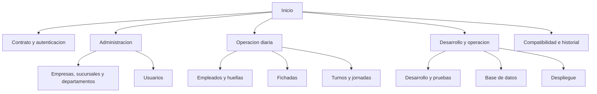

# Documentacion de la API de Control de Fichadas

Esta boveda organiza por temas el contrato HTTP, los flujos operativos y las
indicaciones tecnicas de `ControlFichajes.API`.

## Indice

- [[API/01-Contrato-y-autenticacion|Contrato y autenticacion]]
- [[API/02-Agentes-biometricos|Agentes biometricos]]
- [[Administracion/01-Empresas-y-sucursales|Empresas y sucursales]]
- [[Administracion/02-Usuarios|Usuarios y contrasenas]]
- [[Administracion/03-Departamentos|Departamentos]]
- [[Operacion/01-Empleados-y-huellas|Empleados y huellas]]
- [[Operacion/02-Fichadas|Fichadas]]
- [[Operacion/03-Turnos-y-jornadas|Turnos y jornadas]]
- [[Operaciones/01-Desarrollo-y-pruebas|Desarrollo y pruebas]]
- [[Operaciones/02-Base-de-datos|Base de datos y scripts]]
- [[Operaciones/03-Despliegue|Despliegue]]
- [[Referencia/Compatibilidad|Compatibilidad e historial tecnico]]

## Alcance y fuente

Estas notas contienen la referencia detallada del contrato y la operacion del
proyecto. El `README.md` de la raiz sirve como introduccion y punto de entrada;
no duplica estas guias. La implementacion de la API es la fuente de verdad: si
el comportamiento observado y una nota difieren, verificar el codigo antes de
integrar un cliente.

Requisitos generales: .NET 10 SDK y MySQL 8; Docker es opcional para
despliegue. Los pasos de desarrollo y despliegue estan en sus notas tematicas.

## Mapa de la documentacion

## Navegacion

Las notas se enlazan mediante enlaces internos de Obsidian. Obsidian acepta
enlaces `[[Nota]]` y enlaces Markdown; las rutas a notas en subcarpetas parten
de la raiz de la boveda.

## Mantenimiento y seguridad

Al cambiar endpoints, permisos, cuerpos o respuestas, actualizar las notas
relacionadas de esta boveda y mantener el README como introduccion breve. No
agregar credenciales, JWT, `clientSecret`, cadenas de conexion ni plantillas
biometricas.

Documentacion de Obsidian: [enlaces internos](https://help.obsidian.md/Linking+notes+and+files/Internal+links).
