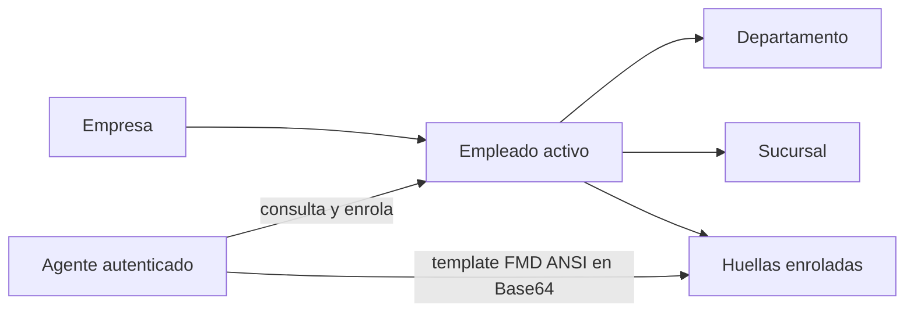

# Empleados y huellas

Volver al [[Inicio|indice]] o consultar [[API/02-Agentes-biometricos|agentes biometricos]].

## Rutas

```text
GET    /api/empleados
GET    /api/empleados/empresa/{empresaId}
GET    /api/empleados/{id}
POST   /api/empleados
PATCH  /api/empleados/{id}
POST   /api/empleados/enrolar
DELETE /api/empleados/{id}
GET    /api/huellas/empresa/{empresaId}
```

El claim `empresa_id` del JWT limita las operaciones a la empresa autorizada.
`PATCH /api/empleados/{id}` actualiza campos del empleado activo, incluidos
legajo, DNI, CUIL, nombre, apellido, departamento, categoria, sucursal y
horario.

## Vinculos de empleado



`DELETE /api/empleados/{id}` es una baja logica: marca `Activo = false`; no
borra fisicamente la fila y el empleado deja de aparecer en listados activos.

## Enrolamiento

El enrolamiento recibe `empleadoId`, `templateHuellaBase64` e `indiceDedo`.
La plantilla debe ser FMD ANSI binaria serializada como Base64; no se acepta
XML. No guardar ni incluir plantillas biometricas en la documentacion,
telemetria o logs.

Los agentes pueden consultar catalogo y huellas y enrolar. Ver
[[API/02-Agentes-biometricos|permisos del agente]].

## Modelo y compatibilidad

El README indica que `Empleado` se mapea a las relaciones reales
`DepartamentoId` y `SucursalId`; los nombres y `TieneHuella` se proyectan en
`EmpleadoDto`. Los listados no deben exponer templates biometricos. Ver
[[Referencia/Compatibilidad|compatibilidad documentada]].
