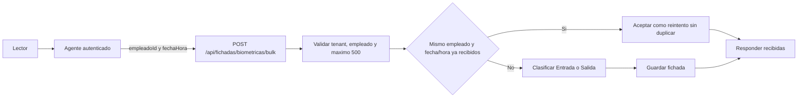
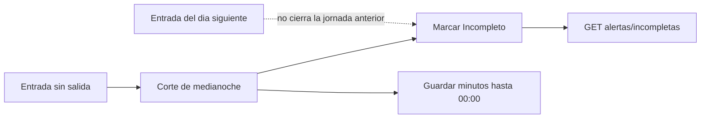

# Fichadas

Volver al [[Inicio|indice]] o consultar [[Operacion/03-Turnos-y-jornadas|turnos, jornadas y alertas]].

## Rutas principales

```text
GET  /api/fichadas?empleadoId=1&desde=2026-08-01&hasta=2026-09-01&tipo=Entrada&metodo=Biometrico&limite=100
POST /api/fichadas/bulk
POST /api/fichadas/biometricas/bulk
```

La consulta `GET` puede filtrar por empleado, rango de fechas, tipo y metodo.
La respuesta incluye `id`, `empleadoId`, nombre, apellido, legajo, fecha/hora,
tipo, metodo, `esManual`, estado, `minutosHastaCorte` cuando la jornada esta
incompleta y `observacion` si existe.

## Recorrido del evento



## Lote biometrico

El lote requiere un token de agente y admite hasta 500 eventos de empleados
activos de la empresa del token. Cada evento lleva `empleadoId` y `fechaHora`;
no se debe enviar `tipoRegistro`.

```http
POST /api/fichadas/biometricas/bulk
Content-Type: application/json

[
  {
    "empleadoId": 1,
    "fechaHora": "2026-10-12T08:59:00"
  }
]
```

Las fechas usan ISO 8601. La API procesa cronologicamente y clasifica
`Entrada`/`Salida` a partir de las fichadas del mismo empleado y fecha
calendario. No empareja una entrada con una salida del dia siguiente.

Un reintento del mismo empleado y fecha/hora no crea una fila duplicada. La
respuesta `{ "recibidas": n }` incluye los eventos aceptados, incluidos los
reconocidos como reintentos.

Valores documentados:

- `TipoRegistro`: `Entrada`, `Salida`.
- `Metodo`: `Biometrico`, `Biométrico`, `Manual`.

## Fichada manual

`POST /api/fichadasmanuales` requiere `ADMIN` o `SuperAdmin`; `RRHH` no puede
crearla. El motivo debe pertenecer al catalogo de observaciones.

```json
{
  "empleadoId": 12,
  "fechaHora": "2026-10-01T09:00:00",
  "tipo": "Entrada",
  "motivo": "OlvidoDeFichaje",
  "detalle": "El lector no registro la entrada"
}
```

La fichada queda con `esManual: true`, `metodo: "Manual"` y conserva usuario y
fecha de auditoria. `GET /api/fichadas` expone estos campos.

## Corte de medianoche

`CorteMedianocheWorker`, registrado mediante `AddHostedService`, corre a
medianoche. Marca como `Incompleto` la entrada del dia anterior sin salida,
guarda los minutos hasta las 00:00 y no permite que una entrada del dia
siguiente cierre la jornada anterior. Las jornadas que requieren revision se
consultan en `GET /api/fichadas/alertas/incompletas`. Al iniciar, el worker espera la
proxima medianoche; no procesa el dia anterior retroactivamente.



## Observaciones y esquema

La observacion tiene relacion 1:1 con `Fichada`. Ver
[[Operaciones/02-Base-de-datos|scripts SQL de observaciones]].
