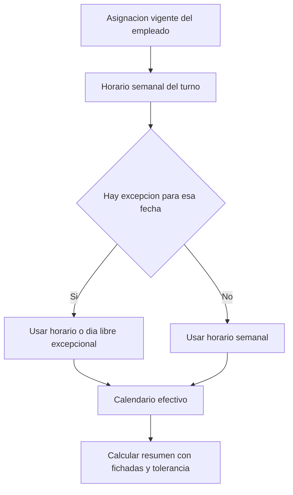

# Turnos y jornadas

Volver al [[Inicio|indice]] o consultar [[Operacion/02-Fichadas|fichadas y alertas]].

## Turnos

```text
GET    /api/turnos
GET    /api/turnos/{id}
POST   /api/turnos
PUT    /api/turnos/{id}
DELETE /api/turnos/{id}
```

Los contratos usan DTOs planos (`TurnoDto`, `TurnoCrearDto`, `TurnoDiaDto`).
`DiaSemana` va de domingo `0` a sabado `6`; cada dia puede incluir
`HoraEntrada` y `HoraSalida`. `ToleranciaMinutos = 0` significa sin
tolerancia. Crear, editar y eliminar requiere `SuperAdmin` o `ADMIN`; todas
las operaciones se aislan por empresa autenticada.

## Como se obtiene el calendario efectivo



El README documenta una comida comun de 60 minutos y el calculo de tiempo
trabajado a partir de fichadas reales, incluidas las salidas y reentradas para
comer. Las horas semanales se configuran por dia de domingo `0` a sabado `6`.
Ejemplo documentado:

```json
{
  "nombre": "Administracion",
  "toleranciaMinutos": 5,
  "dias": [
    { "diaSemana": 1, "horaEntrada": "09:00", "horaSalida": "18:00" },
    { "diaSemana": 2, "horaEntrada": "09:00", "horaSalida": "18:00" },
    { "diaSemana": 3, "horaEntrada": "10:00", "horaSalida": "18:00" },
    { "diaSemana": 4, "horaEntrada": "09:00", "horaSalida": "18:00" },
    { "diaSemana": 5, "horaEntrada": "09:00", "horaSalida": "17:00" }
  ]
}
```

Verificar el comportamiento vigente del proyecto antes de depender de detalles
operativos que hayan cambiado despues de actualizar el README.

## Asignaciones y calendario

Asignar un turno:

```http
POST /api/jornadas/empleados/12/asignaciones
```

```json
{
  "turnoId": 3,
  "fechaInicio": "2026-10-01",
  "fechaFin": null
}
```

Una nueva asignacion cierra la anterior el dia previo y conserva el historial.
Un turno puede asignarse a varios empleados.

Consultar el calendario efectivo:

```text
GET /api/jornadas/empleados/{id}/calendario?desde=2026-10-01&hasta=2026-10-31
```

El resultado indica `tieneTurnoAsignado`, `tieneHorarioConfigurado` y
`esDiaLibre`. Un turno sin dias semanales configurados no se interpreta como
descanso. La instancia descrita en el README tiene asignaciones heredadas en
`Empleado.TurnoId` y `TurnoDia` vacio; hay que cargar los horarios reales.

Se puede reemplazar un solo dia con
`PUT /api/jornadas/empleados/{id}/dias/{fecha}`. El cuerpo documentado contiene
`esDiaLibre`, `horaEntrada`, `horaSalida` y `toleranciaMinutos`. Eliminar la
excepcion con `DELETE` restaura el horario recurrente de ese dia.

Ejemplo del cuerpo para un dia laboral:

```json
{
  "esDiaLibre": false,
  "horaEntrada": "10:00",
  "horaSalida": "16:00",
  "toleranciaMinutos": 0
}
```

## Resumen, reposiciones y alertas

```text
GET  /api/jornadas/empleados/{id}/resumen?desde=2026-10-01&hasta=2026-10-31
GET  /api/jornadas/empleados/{id}/reposiciones?desde=2026-10-01&hasta=2026-10-31
POST /api/jornadas/empleados/{id}/reposiciones
GET  /api/fichadas/alertas/incompletas?desde=2026-10-01&hasta=2026-10-31
```

El resumen usa minutos e incluye saldo diario/total, tardanza sobre la
tolerancia y reposiciones aprobadas. Crear reposiciones y cambiar calendarios
requiere `ADMIN` o `SuperAdmin`. Las alertas web se consultan por polling y
requieren `ADMIN` o `SuperAdmin`.

Ejemplo de reposicion:

```json
{
  "fecha": "2026-10-15",
  "minutos": 60,
  "detalle": "Reposicion autorizada"
}
```
