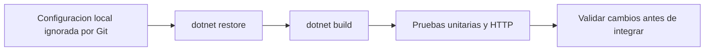
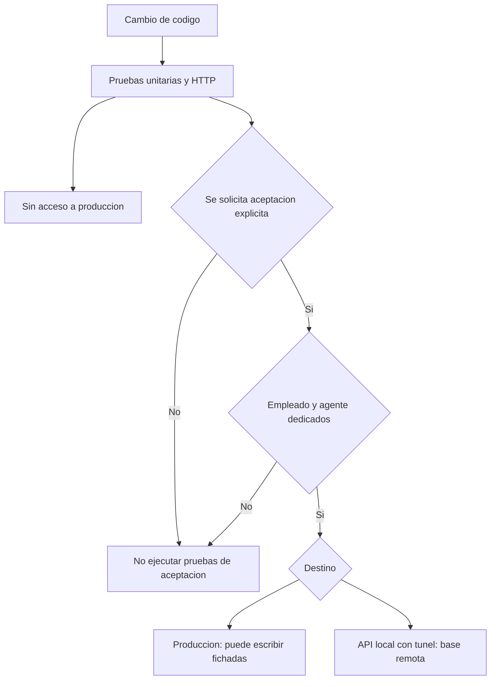

# Desarrollo local y pruebas

Volver al [[Inicio|indice]].

## Configuracion local

Usar como base `ControlFichajes.API/appsettings.Development.local.json.example`
y crear localmente `ControlFichajes.API/appsettings.Development.local.json`.
Configurar conexion MySQL, JWT y CORS sin versionar credenciales reales.
La estructura de ejemplo incluye `ConnectionStrings:DefaultConnection`,
`Jwt:Key`, `Jwt:Issuer`, `Jwt:Audience`, `Jwt:ExpireMinutes` y
`Cors:AllowedOrigins`. El ejemplo local documentado usa el issuer
`ControlFichajes.API.Local`, audience `ControlFichajes.Frontend.Local`,
duracion `60` minutos y origen `http://localhost:5173`; la clave JWT y la
conexion deben ser valores locales seguros, no copiarse a la documentacion.

## Ciclo habitual de validacion



Restaurar y compilar:

```powershell
dotnet restore
dotnet build ControlFichajes.sln
```

Las pruebas estan en `ControlFichajes.API.Tests`. La descripcion del README
indica que las pruebas de autenticacion y empleados usan EF Core InMemory para
no depender de MySQL. Para la corrida habitual segura, el repositorio
recomienda:

```powershell
dotnet test ControlFichajes.sln --configuration Release --filter "Category!=LocalTunnelAcceptance&Category!=ProductionAcceptance"
```

Tambien se documentan estas formas de ejecutar la suite completa; antes de
usarlas, confirmar que los opt-ins de aceptacion no esten habilitados:

```powershell
dotnet test ControlFichajes.API.Tests/ControlFichajes.API.Tests.csproj -nologo
dotnet test ControlFichajes.sln -nologo
```

El documento OpenAPI se publica en desarrollo mediante `MapOpenApi`.

## Cobertura descrita

El README enumera pruebas de registro de usuarios, login con credenciales
invalidas, rechazo de usuarios inactivos, JWT de `SuperAdmin` sin
`empresa_id`, seleccion de empresa mediante `X-Empresa-Id`, sucursales con
contexto `SuperAdmin`, alta/autenticacion/desactivacion de agentes, claims
tenant de agente, limites de lote, validacion de empleados y autorizacion
biometrica, orden cronologico, separacion por empleado y dia, fichadas iguales
y reintentos. Tambien lista prevencion de duplicados en DNI/CUIL, actualizacion
PATCH y baja logica de empleados, enrolamiento de empleados activos,
departamentos con DTOs planos y sin ciclos JSON, unicidad de departamentos por
sucursal, restriccion de modificacion para `RRHH`, corte de medianoche y CRUD
de turnos/horarios aislado por tenant con Moq y xUnit
(`TurnosControllerTests`, `TurnoServiceTests`).

## Pruebas de aceptacion: precaucion

Las pruebas `ProductionBiometricAcceptanceTests` y
`LocalTunnelBiometricAcceptanceTests` estan excluidas del uso rutinario: pueden
escribir en `.devs` de produccion o usar la base remota por tunel SSH. Solo
ejecutarlas con opt-in explicito, agente y empleado dedicado de pruebas, y las
variables configuradas en el proceso o almacen de secretos; nunca usar un
empleado real ni guardar secretos/cadenas de conexion en archivos del
repositorio.

La prueba local usa API en `localhost:5052` y tunel hacia MySQL en
`localhost:3307`; no es una base aislada. La prueba de produccion escribe
fichadas para el empleado de automatizacion y limpia unicamente filas de
prueba identificadas por esa ejecucion. Consultar esta guia y los atributos
de prueba antes de habilitarlas; no basta con copiar un comando.

La suite habitual de unitarias/HTTP no necesita las variables de aceptacion y
no accede a produccion.



### Aceptacion contra produccion

`ProductionBiometricAcceptanceTests` requiere provisionar en `.devs` un agente
y un empleado de pruebas dedicado cuyo legajo comience con
`TEST-AUTOMATION-`. La prueba valida host HTTPS, claim `empresa_id`, nombre de
empresa y empresa/estado/legajo del empleado; elige una fecha futura vacia,
envia dos fichadas y borra solo las filas biometricas del empleado de prueba
con las marcas de tiempo generadas en esa ejecucion. No crea ni modifica
empleados, agentes o empresas. Ante fallas de verificacion o limpieza, revisar
el empleado de automatizacion y la fecha de esa ejecucion antes de repetir.
Nunca usar un empleado real.

El opt-in literal es
`WRITE_TEST_PUNCHES_IN_DEVS_PRODUCTION`. La prueba se invoca con:

```powershell
dotnet test ControlFichajes.API.Tests/ControlFichajes.API.Tests.csproj -nologo --filter "FullyQualifiedName~ProductionBiometricAcceptanceTests"
```

Las variables requeridas son `CFB_PRODUCTION_TEST_OPT_IN`,
`CFB_PRODUCTION_TEST_API_BASE_URL`, `CFB_PRODUCTION_TEST_API_HOST`,
`CFB_PRODUCTION_TEST_DB_CONNECTION`, `CFB_PRODUCTION_TEST_AGENT_CLIENT_ID`,
`CFB_PRODUCTION_TEST_AGENT_CLIENT_SECRET`, `CFB_PRODUCTION_TEST_COMPANY_ID` y
`CFB_PRODUCTION_TEST_EMPLOYEE_ID`.

### Aceptacion local con tunel SSH y lector

`LocalTunnelBiometricAcceptanceTests` valida el agente, tenant `.devs`,
empleado dedicado `TEST-AUTOMATION-`, huella del dedo seleccionado creada
durante la ejecucion y una fecha futura vacia. Envia dos fichadas a la API
local y limpia solo esa huella y las fichadas biometricas de ese empleado
desde el instante de inicio configurado, incluso si falla una asercion. El
inicio UTC debe ser anterior al enrolamiento; no usar ese empleado para otras
operaciones durante la prueba. La aceptacion no crea el template: comprueba el
que la aplicacion acaba de guardar.

El opt-in literal es `WRITE_TEST_DATA_FOR_DEDICATED_DEVS_EMPLOYEE`. Configurar
`CFB_LOCAL_TEST_API_BASE_URL` como `http://localhost:5052/`, iniciar la API con
configuracion local y tunel MySQL a `localhost:3307`, enrolar el dedo y luego
ejecutar:

```powershell
dotnet test ControlFichajes.API.Tests/ControlFichajes.API.Tests.csproj --filter "FullyQualifiedName~LocalTunnelBiometricAcceptanceTests"
```

La prueba local tambien esta excluida por defecto; no habilitar su opt-in en
CI.

Las variables locales son `CFB_LOCAL_TUNNEL_TEST_OPT_IN`,
`CFB_LOCAL_TEST_API_BASE_URL`, `CFB_LOCAL_TEST_DB_CONNECTION`,
`CFB_LOCAL_TEST_DB_NAME`, `CFB_LOCAL_TEST_AGENT_CLIENT_ID`,
`CFB_LOCAL_TEST_AGENT_CLIENT_SECRET`, `CFB_LOCAL_TEST_COMPANY_ID`,
`CFB_LOCAL_TEST_EMPLOYEE_ID`, `CFB_LOCAL_TEST_EMPLOYEE_LEGAJO`,
`CFB_LOCAL_TEST_FINGER_INDEX` (1-10) y `CFB_LOCAL_TEST_STARTED_AT_UTC`.

No registrar valores de esas variables en estas notas.
