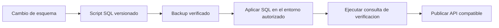

# Base de datos y scripts

Volver al [[Inicio|indice]] o consultar [[Administracion/02-Usuarios|seguridad de usuarios]] y [[Operacion/02-Fichadas|observaciones de fichadas]].

## Motor y cambios de esquema

La API utiliza MySQL 8. El README indica que el repositorio no versiona el
esquema mediante migraciones de EF Core; los cambios incrementales se
documentan en `database/YYYYMMDD_descripcion.sql`.



Antes de ejecutar SQL en un entorno real, generar y verificar un backup, revisar
el script y seguir el orden de despliegue que corresponda. No ejecutar scripts
de base de datos desde el entorno local sin autorizacion.

## Seguridad de usuarios

`database/20260910_usuario_seguridad.sql` agrega idempotentemente:

```text
RequiereCambioPassword
IntentosFallidos
BloqueadoHasta
UltimoIntentoFallido
PasswordTemporalVenceEn
PasswordTemporalUsada
TokenVersion
```

El script comprueba `information_schema.COLUMNS`; el README lo declara
compatible con MySQL 8.0.42. Secuencia publicada: **backup -> SQL -> API ->
frontend**. Ejecutar y revisar la consulta de verificacion incluida. Los JWT
web anteriores sin `token_version` son rechazados por el binario nuevo.

La comprobacion por columna evita depender de `ADD COLUMN IF NOT EXISTS`.
Segun el README, el script puede ejecutarse sobre el esquema original, sobre
el servidor que ya tiene las primeras seis columnas, y mas de una vez sin
eliminar usuarios.

El rollback manual esta en el mismo script. El README advierte que no debe
eliminarse una columna que el binario desplegado mapea; conservar el esquema
aditivo durante un rollback de binario.

## Autenticacion, sesiones y MFA

Para instalaciones existentes, los cambios posteriores de seguridad se
aplican con scripts incrementales, en orden:

```text
20261103_autenticacion_seguridad.sql
20261104_sesion_generacion.sql
20261105_mfa_persistencia.sql
20261106_mfa_enrolamiento.sql
20261110_usuario_eliminado.sql
```

El esquema limpio `20261023_esquema.sql` ya incorpora estas estructuras. Los
scripts incrementales no se vuelven a ejecutar despues de ese snapshot. El
README de `database/` describe el orden completo para bases existentes y las
condiciones de cada script.

Los cambios agregan persistencia para invitaciones y recuperacion de
contrasena, auditoria, sesiones renovables y generaciones de cookie, desafios
y secretos MFA, codigos de recuperacion y la marca de baja logica
`Usuario.EliminadoEn`. Antes de ejecutar cualquier script en un entorno real,
respaldar la base, verificar el esquema y seguir la secuencia autorizada; no
ejecutar rollbacks como parte de una instalacion.

## Observaciones de fichadas

La tabla `FichadaObservacion` tiene relacion 1:1 con `Fichada` y usa:

```text
database/20260914_fichada_observacion.sql
database/20260914_fichada_observacion.rollback.sql
```

El script forward es idempotente y no modifica `Fichada`, `Empleado` ni
`Usuario`. Orden publicado: **backup -> SQL -> API**. No ejecutar estos
scripts desde el entorno de desarrollo descrito en el README.

## Seguridad operacional

No copiar connection strings, valores de secretos, JWT, `clientSecret`,
templates biometricos ni valores reales de variables `CFB_*` en esta boveda.
Usar archivos de configuracion locales ignorados por Git y ejemplos
desprovistos de secretos.
