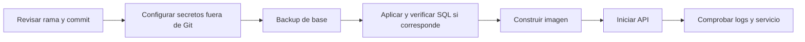

# Despliegue

Volver al [[Inicio|indice]]. Esta nota organiza el procedimiento del README;
no autoriza ni ejecuta despliegues.

## Secuencia de despliegue



## Requisitos

En el servidor, comprobar Docker Compose:

```bash
docker compose version
```

Si falta el plugin, instalar `docker-compose-plugin` mediante el gestor de
paquetes de la distribucion y comprobar la version. En sistemas Debian/Ubuntu,
el README documenta:

```bash
sudo apt-get update
sudo apt-get install -y docker-compose-plugin
docker compose version
```

## Preparacion y configuracion

Clonar el repositorio y acceder al proyecto:

```bash
git clone https://github.com/SamusSalinas/ControlFichajes.API.git
cd ControlFichajes.API
```

Crear `.env.production` desde `.env.production.example` y configurar
localmente la conexion MySQL, JWT y CORS. No subir `.env.production` ni poner
valores reales en la plantilla o en esta boveda.

Las variables de configuracion documentadas son:
`ConnectionStrings__DefaultConnection`, `Jwt__Key`, `Jwt__Issuer`,
`Jwt__Audience`, `Jwt__ExpireMinutes` y `Cors__AllowedOrigins__0`. La plantilla
es un ejemplo sin credenciales reales; `Jwt__Key` debe ser largo, aleatorio y
secreto.

Las rutas de invitacion y recuperacion usan `App:PublicBaseUrl` para formar sus
enlaces. El correo saliente se administra por
[[API/03-Seguridad-web|la API de correo saliente]] o mediante configuracion
local del servidor. El cifrado de secretos MFA requiere provisionar
`Auth:TotpClaves:Activa` y `Auth:TotpClaves:Lectura` fuera del repositorio y
respaldarlas de forma segura. No copiar claves, contrasenas SMTP ni URLs con
tokens a la boveda o a la plantilla de variables.

## Construccion y operacion

```bash
docker compose up -d --build
docker compose logs -f api
```

El README describe el contenedor usando la red del host para MySQL en
`127.0.0.1:3306` y publica la API en el puerto `8080`. Confirmar el entorno y
la configuracion de red antes de aplicar estos ejemplos.

El README recomienda no almacenar contrasenas en texto plano, no versionar
`.env.production` ni `appsettings.Development.local.json` con credenciales,
usar una clave JWT larga y aleatoria, limitar CORS a origenes autorizados y
utilizar HTTPS al pasar de pruebas a un entorno definitivo.

Para actualizar un despliegue existente, el README muestra `git pull` y
`docker compose up -d --build`. No ejecutar esos pasos sin validar la rama,
el commit, los cambios y la autorizacion de despliegue del entorno.

## Referencias

- [[Operaciones/01-Desarrollo-y-pruebas|Desarrollo y validacion]]
- [[Operaciones/02-Base-de-datos|Orden de aplicacion de scripts SQL]]
- [[Referencia/Compatibilidad|Cambios de compatibilidad documentados]]
