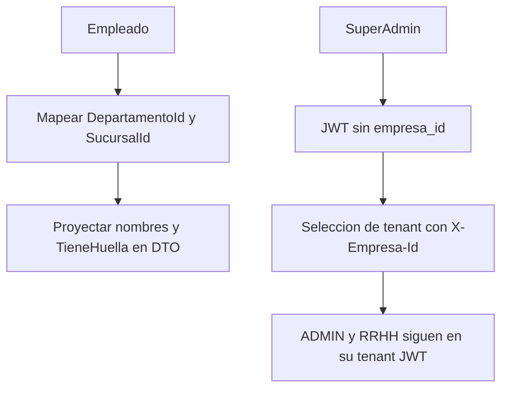

# Compatibilidad e historial tecnico

Volver al [[Inicio|indice]]. Esta nota resume las secciones de compatibilidad,
validacion e historial que aparecen en el README; no es un contrato nuevo de
endpoints.

## Resumen de cambios descritos

## Empleados

El README documenta un modelo `Empleado` previamente desalineado con
produccion: EF esperaba columnas de texto `Departamento` y `Sucursal`. El
cambio minimo mapea `DepartamentoId` y `SucursalId`; nombres y `TieneHuella`
se proyectan en `EmpleadoDto`. No requiere cambio de base segun esa tabla.

## SuperAdmin y empresas

La compatibilidad descrita elimina `empresa_id` del JWT web de `SuperAdmin`,
permite listado global de empresas y usa `X-Empresa-Id` como contexto tenant.
`ADMIN` y `RRHH` siguen restringidos a la empresa del JWT. La tabla del README
marca este cambio como sin cambio de base.

## Comparaciones historicas

El README conserva comparaciones entre las ramas historicas
`pruebas/api-estable` y `pruebas/api-estable-corregida`:

- `Huella.cs`: se quito la inicializacion erronea `string.Empty` de
  `IndiceDedo` (propiedad `int` requerida); la declaracion final es
  `[Required] public int IndiceDedo { get; set; }`.
- `HuellasController.cs`: la proyeccion final incluye `IndiceDedo` en lugar de
  `NombreDedo`, junto con `Id`, `EmpleadoId` y `TemplateBiometrico`.
- `.env.production.example`: la version corregida documentaba conexion
  MySQL con campos de reemplazo, `Jwt__Key`, `Jwt__Issuer`,
  `Jwt__Audience`, `Jwt__ExpireMinutes` y `Cors__AllowedOrigins__0`. No copiar
  secretos ni valores concretos de configuracion; usar la plantilla actual.
  La conexion de ejemplo apuntaba a `127.0.0.1:3306` y usaba marcadores de
  reemplazo para la base y el usuario; no registrar credenciales.

## Estado de validacion publicado

El README historico registra una compilacion local con .NET 10 que finalizo
correctamente y una lista de pruebas cubiertas. Para el estado actual ejecutar
las instrucciones de [[Operaciones/01-Desarrollo-y-pruebas|desarrollo y pruebas]];
no asumir que una validacion anterior cubre cambios posteriores.
