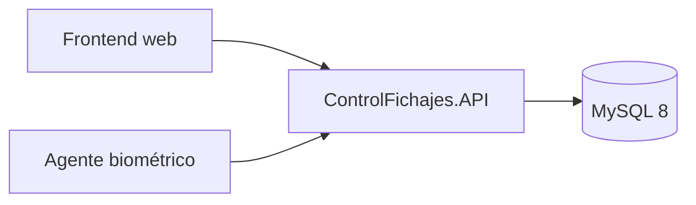

# ControlFichajes.API

API REST para la gestión de empresas, usuarios, empleados, agentes biométricos,
turnos y fichadas. Es la fuente de verdad del contrato HTTP y de las reglas de
negocio que consumen el frontend y el cliente biométrico.

## Documentación

La [bóveda de documentación](<Documentacion API control de fichadas/Inicio.md>)
es la referencia detallada del proyecto: contrato HTTP, autenticación,
administración, operación, base de datos, desarrollo y despliegue. Consultá el
índice para elegir la guía correspondiente; este README se mantiene como punto
de entrada, sin duplicar esas instrucciones.

- [Contrato HTTP y autenticación](<Documentacion API control de fichadas/API/01-Contrato-y-autenticacion.md>)
- [Seguridad web, sesiones y MFA](<Documentacion API control de fichadas/API/03-Seguridad-web.md>)
- [Administración de usuarios](<Documentacion API control de fichadas/Administracion/02-Usuarios.md>)
- [Desarrollo y pruebas](<Documentacion API control de fichadas/Operaciones/01-Desarrollo-y-pruebas.md>)
- [Base de datos](<Documentacion API control de fichadas/Operaciones/02-Base-de-datos.md>)
- [Despliegue](<Documentacion API control de fichadas/Operaciones/03-Despliegue.md>)

La implementación es la fuente de verdad: si una guía y el código difieren,
verificá el comportamiento antes de integrar un cliente.

## Requisitos

- .NET 10 SDK
- MySQL 8
- Docker opcional para despliegue

Para configurar el entorno local, ejecutar las pruebas o desplegar, seguí las
guías de la bóveda. No guardes en el repositorio credenciales, claves,
connection strings, tokens ni datos biométricos.
